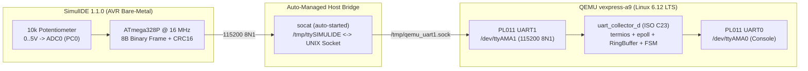

# SimulIDE AVR Sensor Node & POSIX C23 UART Collector on QEMU

> Hardware-in-the-Loop (HIL) co-simulation bridging a bare-metal ATmega328P
> firmware in **SimulIDE 1.1.0** to an **ARMv7 Embedded Linux 6.12 LTS** guest
> in **QEMU (`vexpress-a9`)** via Dual-UART, driven by an event-based **ISO C23
> / MISRA C:2025** `epoll` telemetry daemon.

[][u-kern]
[][u-uboot]
[][u-avr]
[][u-c23]
[][u-sim]
[][u-qemu]
[License](https://www.google.com/search?q=./LICENSE)

**Engineering Monograph:**
[Read the 52-Page Technical Specification (PDF)](./docs/Project_03_Simulide_Dualuart_Technical_Specification.pdf)

---

## Overview

Industrial embedded gateways routinely pair a bare-metal microcontroller
(sampling analog sensors deterministically) with an Embedded Linux processor
over an asynchronous UART link. This project implements and automates the full
Hardware-in-the-Loop pipeline without requiring physical boards:

1. **Bare-Metal AVR Sensor Node (`firmware_avr/`):** Direct register-level C
   firmware for **ATmega328P @ 16 MHz** (`ADMUX`/`ADCSRA` 10-bit ADC at
   `125 kHz`, `UCSR0A/B/C` USART0 at `115200 8N1` with `U2X0 = 1`) transmitting
   8-byte CRC-16/CCITT-FALSE binary frames at 5 Hz.
1. **Automatic Virtual Bridge (`socat` + UNIX Socket):** `make demo`
   automatically creates QEMU's second PL011 UART socket
   (`/tmp/qemu_uart1.sock`) and spawns a background `socat` bridge exposing
   `/tmp/ttySIMULIDE` for SimulIDE, cleaning it up automatically on exit.
1. **Embedded Linux ARMv7 Stack (`vexpress-a9`):** Reproducible 4-stage boot
   chain (**Das U-Boot v2025.10** -> **Linux 6.12 LTS** -> **BusyBox 1.37.0
   Initramfs**) packaged rootlessly into an MBR `sdcard.img`.
1. **Asynchronous POSIX Telemetry Daemon (`uart_collector_d`):** Written in
   strict **ISO C23**, combining non-blocking `termios` raw mode, `epoll_wait`,
   a power-of-two static circular **Ring Buffer** (zero `malloc`/`free`), and
   an alignment-safe FSM frame decoder audited with ASan and UBSan.

---

## System Architecture

### Hardware-in-the-Loop Data Flow



### Binary UART Frame Wire Contract (8 Bytes, Little-Endian)

| Offset | Field | Size | Type / Value | Description |
| :--- | :--- | :--- | :--- | :--- |
| `0..1` | `sof` | 2 B | `0xAA 0x55` | Alternating Start-of-Frame sync |
| `2..3` | `seq_id` | 2 B | `uint16_t` LE | Packet counter (`0..65535`) |
| `4..5` | `adc_raw` | 2 B | `uint16_t` LE | 10-bit ADC (`0..1023`) |
| `6..7` | `crc16` | 2 B | `uint16_t` LE | CRC-16/CCITT over `0..5` |

* **Golden Test Vector (`seq_id = 1`, `adc_raw = 512`):**
  `AA 55 01 00 00 02 A9 09` (`CRC-16 = 0x09A9`, `Voltage = 2.502 V`).

---

## Engineering Decisions & Problem Solving

* **Zero-Heap Determinism (MISRA C:2025 & ISO C23):** Uses a 512-byte
  power-of-two static `ring_buffer_t` with single-cycle bitmask wrap-around
  (`& RB_MASK`), `<stdckdint.h>` overflow guards (`ckd_add`, `ckd_mul`),
  `[[nodiscard]]` contracts, and alignment-safe Little-Endian decoding
  (`read_u16_le`) to prevent ARMv7 unaligned access faults.
* **UNIX Domain Socket + Auto-Bridge:** Binding QEMU's UART1 to
  `-chardev socket,server=on,wait=off` eliminates host PTY `termios` conflicts,
  while `07_run_qemu.sh` auto-starts `socat` in the background so `make demo`
  exposes `/tmp/ttySIMULIDE` immediately with zero extra terminals.
* **ATmega328P Double-Speed UART (`U2X0 = 1`):** At `16 MHz` and `115200 bps`,
  enabling `U2X0` sets `UBRR0 = 16`, lowering the clock baudrate error from
  `-3.55%` to `+2.12%` per the ATmega328P datasheet.
* **Rootless Packaging (`zero sudo`):** Builds `uInitramfs` with
  `cpio --owner=+0:+0` and creates an MBR-partitioned FAT32 `sdcard.img` via
  `sfdisk` + `mtools` (`mcopy`/`mdir`), avoiding `losetup`/`mount` privileges.

---

## Quick Start

### Prerequisites

* **Host OS:** Ubuntu 22.04 / 24.04 LTS or Debian 12/13 (`x86_64`)
* **Tooling:** `arm-linux-gnueabihf-gcc`, `gcc-avr`, `avr-libc`,
  `qemu-system-arm`, `socat`, `u-boot-tools`, `dosfstools`, `mtools`, `fdisk`
  *(auto-installed by `make deps`)*
* **Optional GUI Simulator:** [SimulIDE 1.1.0 Stable][u-sim] for live
  potentiometer co-simulation *(headless injection works without SimulIDE)*.

### Step 1: Build Everything & Boot QEMU (`make demo`)

Clone the repository and run `make demo`. This single command installs missing
tools, builds U-Boot, Linux 6.12 LTS, BusyBox, `sensor_node.hex`, and
`uart_collector_d`, packages `sdcard.img`, auto-starts the `/tmp/ttySIMULIDE`
bridge, and boots QEMU:

```bash
git clone https://github.com/USER/p03-simulide-uart-posix-daemon.git
cd p03-simulide-uart-posix-daemon
make demo
```

Once Linux boots into the BusyBox shell (`/ #`), start the C23 collector:

```sh
uart_collector_d /dev/ttyAMA1
```

### Step 2A: Live Co-Simulation with SimulIDE 1.1.0 (Recommended)

With `make demo` running and `uart_collector_d /dev/ttyAMA1` listening:

1. Launch **SimulIDE 1.1.0** (`simulide` or the official Linux AppImage) and
   open `circuit/sensor_node.sim1`.
1. **Load the compiled bare-metal firmware:** Right-click the **Arduino Uno**
   board -> **Load firmware** -> select `firmware_avr/sensor_node.hex`.
1. **Connect to the auto-created port:** Click the **Open** button on the blue
   `Serial Port` block (`/tmp/ttySIMULIDE`, `115200 8N1`). The button label
   changes to **Close** once attached.
1. **Start Simulation:** Click the red **Power** button in SimulIDE's toolbar.
   The Pin 13 LED blinks every `200 ms`, and rotating the `10 kOhm`
   potentiometer updates ADC and voltage readings live inside QEMU.

### Step 2B: Manual Headless Testing (Without SimulIDE Installed)

If you do not have **SimulIDE** installed, you can verify the complete QEMU
PL011 UART1 + `termios` + `epoll` + Ring Buffer + CRC-16 pipeline directly
from a second host terminal by injecting binary frames into QEMU's UNIX socket:

1. **Automated Injection (`make test-inject`):** Sends 2 noise bytes
   (`0xFF 0x00`) followed by the 8-byte Golden Test Vector (`ADC = 512`):

   ```bash
   make test-inject
   ```

1. **Custom Manual Injection (Full-Scale `ADC = 1023`, `5.000 V`):**

   ```bash
   printf '\xaa\x55\x02\x00\xff\x03\xab\x81' | \
       socat - UNIX-CONNECT:/tmp/qemu_uart1.sock
   ```

**Expected Output inside QEMU:**

```text
[INFO] uart_collector_d listening on /dev/ttyAMA1 (115200 8N1 raw, epoll)...
[RX #00001] ADC:  512 / 1023 | Voltage: 2.502 V | CRC: 0x09A9 [OK]
```

> **Exiting:** Press `Ctrl + C` inside QEMU to print the session summary
> (`Valid frames / CRC errors / Dropped frames / Resync bytes`), then press
> `Ctrl + A`, release both keys, and press `X` to exit QEMU (the background
> `socat` bridge is cleaned up automatically).

---

## Repository Structure

```text
p03-simulide-uart-posix-daemon/
├── .gitignore                   # Excludes upstream trees, build/ & .img
├── LICENSE                      # GNU GPL-2.0
├── Makefile                     # Orchestrator (demo, direct, test-inject)
├── README.md                    # Portfolio documentation
├── circuit/
│   └── sensor_node.sim1         # Pre-wired SimulIDE 1.1.0 circuit
├── docs/
│   └── Project_03_Complete_Engineering_Monograph.pdf
├── firmware_avr/
│   ├── Makefile                 # avr-gcc build + host CRC unit test
│   ├── include/                 # frame.h, crc16.h, uart.h, adc.h
│   ├── src/                     # main.c, uart.c, adc.c, crc16.c
│   └── tests/                   # test_crc16.c (Golden Test Vector)
├── scripts/
│   ├── 01_install_deps.sh       # Host, AVR & ARM dependency checker
│   ├── 02_build_uboot.sh        # Das U-Boot v2025.10 cross-build
│   ├── 03_build_kernel.sh       # Linux 6.12 LTS (PL011 Dual-UART + epoll)
│   ├── 04_build_busybox.sh      # BusyBox 1.37.0 static RootFS + rcS
│   ├── 05_build_apps.sh         # AVR HEX + ASan/UBSan + ARMv7 collector
│   ├── 06_package_images.sh     # Rootless uInitramfs + MBR sdcard.img
│   └── 07_run_qemu.sh           # QEMU Dual-UART + auto socat bridge
└── user/
    └── uart_collector/
        ├── Makefile             # ASan/UBSan tests + ARMv7 static build
        ├── include/             # c23_compat.h, ring_buffer.h,
        │                        # frame_parser.h, serial_port.h
        ├── src/                 # main.c, ring_buffer.c, frame_parser.c,
        │                        # serial_port.c
        └── tests/               # test_ring_buffer.c, test_parser.c
```

---

*Part 3 of a progressive **Embedded Linux & Linux Kernel Engineering
Portfolio** covering QEMU, Renode, SimulIDE, Kernel Drivers, Yocto,
PREEMPT_RT, eBPF, and Embedded Security.*

**License:** [GNU General Public License v2.0](https://www.google.com/search?q=./LICENSE)


[u-kern]: https://www.kernel.org/releases.html

[u-uboot]: https://docs.u-boot.org/en/v2025.07/develop/release_cycle.html

[u-avr]: https://www.microchip.com/en-us/product/atmega328p

[u-c23]: https://cppreference.net/c/23.html

[u-sim]: https://simulide.com/p/download110/

[u-qemu]: https://qemu-project.gitlab.io/qemu/system/arm/vexpress.html


